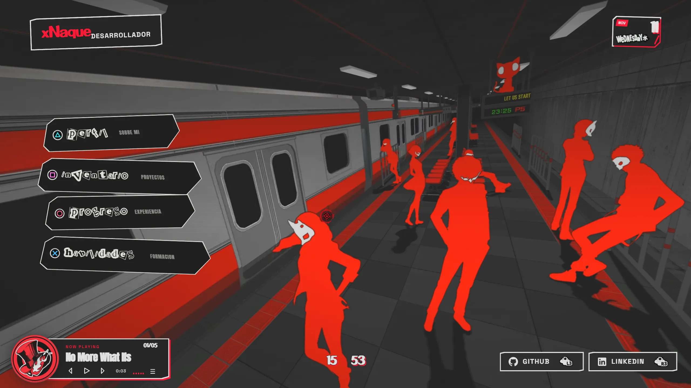
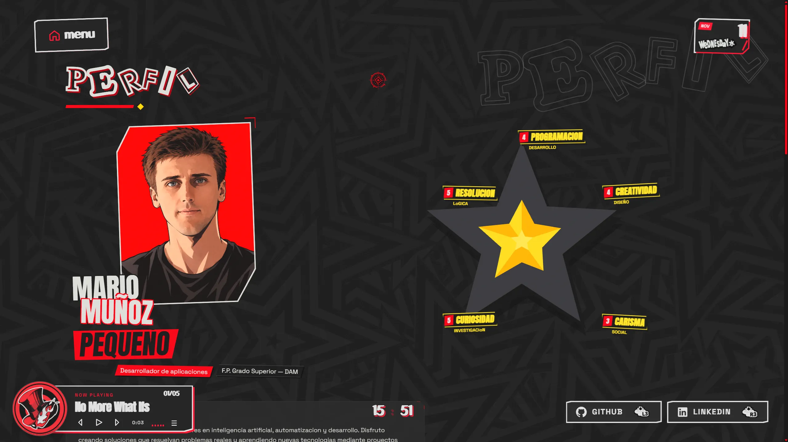
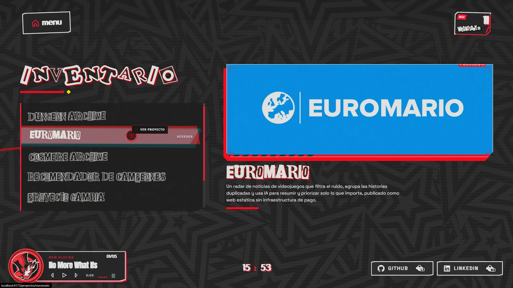
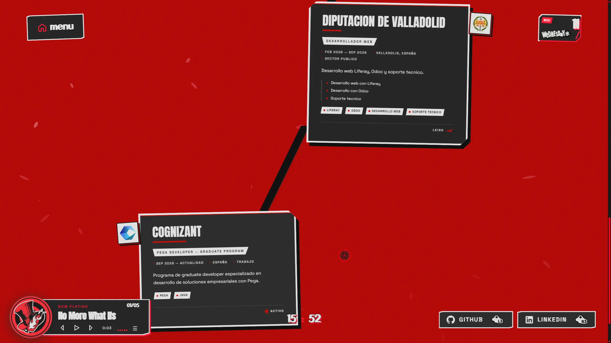
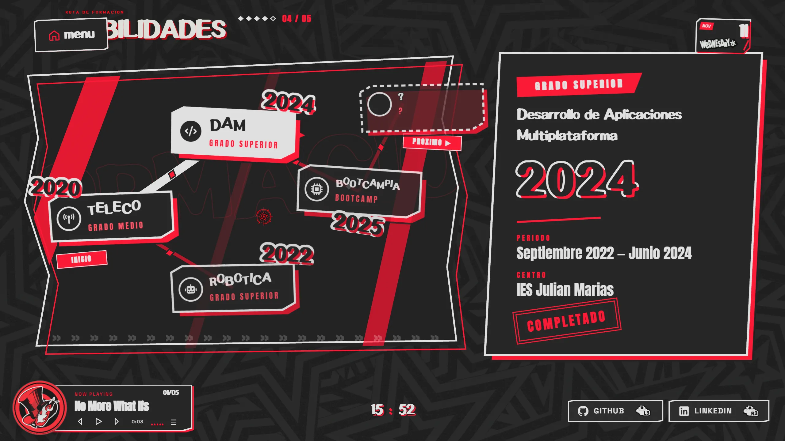

# Mario Muñoz Pequeño — Portfolio

Portfolio personal e interactivo con estética inspirada en Persona 5. Desarrollador de aplicaciones en Valladolid, España.

🔗 Demo: https://mariomunpeq.is-a.dev/

## Capturas

Capturas generadas con Playwright contra `pnpm preview` (documentación y buscadores).

| Página | Captura |
|--------|---------|
| Inicio |  |
| Perfil |  |
| Inventario |  |
| Progreso |  |
| Formación |  |
| 404 |  |

## Qué incluye

El sitio es un portfolio / "CV viviente" con las siguientes secciones y características:

- **Perfil**: información personal, biografía, habilidades (Social Stats al estilo Persona 5), permiso de conducir y escena de conducción.
- **Inventario**: listado de proyectos con selector por filas y vista previa de cada uno.
- **Progreso**: experiencia laboral presentada como conversación con burbujas, avatares de empresa y sellos de lectura.
- **Habilidades**: formación académica en árbol de habilidades tipo sistema de juego, con nodos, rutas y panel de detalle.
- **Fichas de proyecto**: detalle de cada proyecto con galería, stack, features, rol, retos y enlaces.
- **Música**: reproductor de fondo integrado con 5 pistas, ecualizador y vinilo animado.
- **Cursor personalizado**: retículo contextual con etiquetas (se desactiva en táctil o con reduced motion).
- **Transiciones de ruta**: transición de vídeo (tren) y fundido a negro entre secciones.
- **Calendario de carga**: pantalla de introducción tipo calendario con caída de fechas y cuchillo.
- **Reloj digital** en la barra inferior con enlaces sociales.

## Stack

React 19, TypeScript, Vite 8, Tailwind CSS, GSAP, Lenis, Motion, React Router, Playwright, oxlint.

## Cómo ejecutarlo

Requisitos: Node.js y pnpm.

```bash
# Instalar dependencias
pnpm install

# Entorno de desarrollo (Vite)
pnpm dev

# Build de producción (TypeScript + Vite + prerrender de metadatos)
pnpm build

# Previsualizar el build
pnpm preview

# Comprobación de tipos
pnpm typecheck

# Lint
pnpm lint

# Formato
pnpm format
pnpm format:check
```

## Estructura de carpetas

```
src/            Código fuente de la aplicación
  components/   Componentes React reutilizables
  pages/        Páginas de ruta (Home, About, Projects, Experience, Education, ProjectDetail, NotFound)
  data/         Datos estáticos (proyectos, perfil, experiencia, formación, música, metadatos SEO)
  lib/          Utilidades (boot, media query, calendario, logos de empresa)
  styles/       Tokens de estilo (tipografía, colores, utilidades Tailwind)
  transition/   Componentes de transición de ruta y pantalla de carga
public/         Assets estáticos (imágenes, vídeos, fuentes, audio, OG, manifest)
scripts/        Scripts de build (prerender de metadatos por ruta)
tests/          Pruebas de Playwright
dist/           Salida del build de producción
```

## Rendimiento y SEO

- **Code splitting**: las rutas pesadas (`/education` y `/proyectos/:slug`) se cargan con `React.lazy` + `Suspense`; el vendor se separa en chunks (`vendor-react`, `vendor-gsap`, `vendor-motion`, `vendor`).
- **Fuentes autoalojadas**: Anton, Space Grotesk, Caveat y Share Tech Mono en WOFF2 con `font-display: swap`; eliminada la petición render-bloqueante a Google Fonts.
- **Imágenes WebP**: capturas de proyecto convertidas a WebP; `loading="lazy"` y `decoding="async"` en capturas no críticas; `width`/`height` para evitar saltos de layout (CLS).
- **Prerender de metadatos**: título, descripción, canonical, Open Graph y Twitter generados por ruta durante el build (`scripts/prerender-metadata.mjs`).
- **Sitemap y robots.txt**: `sitemap.xml` con las 12 rutas indexables y `robots.txt` permitiendo rastreo.
- **404**: ruta `/404` + `*` con página `404.html` generada en el prerrender.
- **JSON-LD**: esquema `Person` con nombre, rol, descripción, URL, imagen, enlaces sociales y dirección.

## Despliegue

Despliegue automático en GitHub Pages mediante el workflow `.github/workflows/deploy.yml` (despliega en push a `main` usando `actions/deploy-pages@v4`).

Mario Muñoz Pequeño · Desarrollador de aplicaciones · Valladolid, España
